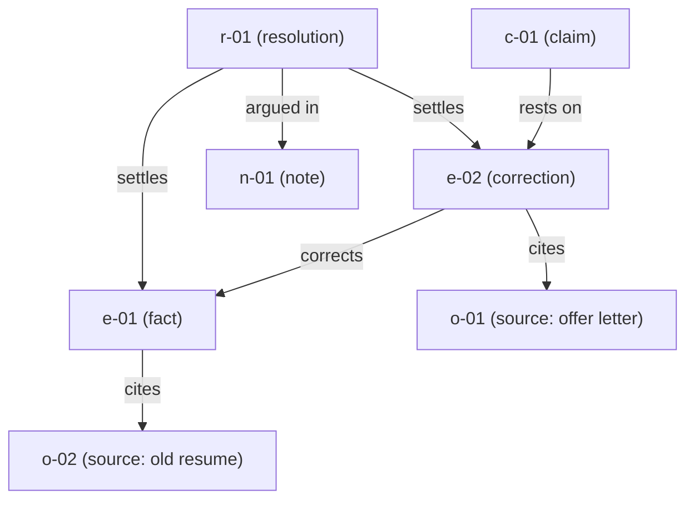

# The record model

This is what `track-record record` checks, and what it cannot. Every example here is invented. None of it comes from a real person's records, employers or claims.

## A record is a graph

A career record kept as tables is a graph. Each row of a table is a node, named by its key. Each reference from one row to another is an edge. A fact that names its source is an edge from the fact to the source; a correction that names the fact it corrects is an edge from the correction to the fact.

Tables are plain files, one row per line. The check reads them and follows the edges. It does not care how the rows got there.

## Kinds of record (nodes)

These are the terms [METHOD.md](../METHOD.md) uses.

- **fact:** an entry in the record, appended with its source and the date it was recorded, and graded for how strong the source is.
- **source:** where a fact is known from: an offer letter, an old résumé, a colleague's memory.
- **correction:** a new entry that points at the entry it corrects and says why. The corrected entry stays where it was.
- **resolution:** the value the record settles on when sources disagree, the basis for it, and how firm it is.
- **claim:** a fact as it appears on a résumé or a profile, linked back to the facts behind it.
- **note:** the argument behind a resolution, kept apart from the answer.

## Kinds of reference (edges)

- **cites:** a fact to its source.
- **corrects:** a correction to the fact it corrects.
- **settles:** a resolution to the facts it weighs.
- **rests on:** a claim to the facts behind it.
- **argued in:** a resolution to the note that holds its reasoning.

A cell can hold references in three ways, which the declaration names as a rule (the spec's section 3.3):

- `single`: the cell, exactly as written, is one reference.
- `list CHARACTERS`: the cell is a list, split at the characters you name, such as `list ,;`. Spaces around each part are dropped.
- `pattern REGEX`: every match of a regular expression in the cell is a reference, so a reference can sit inside a sentence.

## An invented example

Seven nodes. The ids are made up.



The same graph in plain text, each arrow read as "points at":

```text
c-01 claim --rests on--> e-02 correction --corrects--> e-01 fact
                         e-02 correction --cites-----> o-01 source
                         e-01 fact       --cites-----> o-02 source
r-01 resolution --settles--> e-01, e-02
r-01 resolution --argued in--> n-01 note
```

The declaration that checks it (this one is invented too; the tables are `entry-table.tsv`, `origin-table.csv`, `resolution-table.tsv`, `note-table.tsv` and `claim-table.tsv`, each with the columns the declaration names):

```text
# invented example
tables:
  entries | entry-table.tsv | tsv | entry
  origins | origin-table.csv | csv | origin
  resolutions | resolution-table.tsv | tsv | resolution
  notes | note-table.tsv | tsv | note
  claims | claim-table.tsv | tsv | claim
references:
  entries | cites | origins | origin | list ,
  resolutions | settles | entries | entry | list ,
  resolutions | argued_in | notes | note | single
  claims | rests_on | entries | entry | list ,
required:
  entries | grade
values:
  entries | grade | A | B | C | D
dates:
  entries | recorded
corrections:
  entries | corrects | recorded
earlier:
  entries | entry-table-before.tsv
```

A smaller example, with its exact output, is in the README, and the rules are in [docs/specs/record-check.md](specs/record-check.md).

## Append-only with corrections

- **Append, never edit.** A new fact is a new row at the end of the file.
- **A correction is a new row.** It points back at the row it corrects and says why. The corrected row stays.
- **File order and date order agree.** A correction comes after the row it corrects, and is dated no earlier than that row.
- **An earlier copy is still the exact start.** If you keep a copy of the file from last month, this month's file begins with exactly those bytes. A single edited character in an old row breaks that, and the check says on which line.
- **A reader applies corrections in file order.**
- **A program that writes the record refuses a tab or a line break inside a cell** rather than replacing it. A stray tab shows up in the check as a row with the wrong number of fields.

## Two clocks on the graph

A record answers two questions. What is true: apply every correction, whenever it was made. What did the record say on a date: leave out the corrections dated after it. The check verifies the dates, so the second view can be trusted when someone builds it. It does not build that view.

## The check for each

| Part of the model | Which `track-record record` check covers it |
|---|---|
| a node has a key, and keys are unique | the table check: empty key, repeated key |
| a row is whole | the table check: a row with the wrong number of fields is named, which also shows a stray tab |
| cites, settles, rests on, argued in | the references check: a dangling reference, one that points at nothing, is named by line |
| the three ways a cell holds references | the cell rule on each reference item: `single`, `list`, `pattern` |
| corrects | the corrections check: a correction of itself, of a ragged row, of a missing row, of a key that is not unique, of a later row |
| correction dated no earlier than its target | the corrections check: dates that cannot be compared, a date before the corrected row's |
| every fact is graded | the required check on the grade column, and the values check against the grades you allow |
| a date is a real date | the dates check |
| append only | the earlier-copy check: the earlier file is still the exact start of the file now |
| a check that looked at nothing | a DEAD result, never an OK |

## What the model doesn't do

- It judges no truth. A fact can cite a source and still be wrong.
- It merges no sources. Two rows that mean the same thing stay two rows.
- It mints no ids. You choose the keys, and the check only finds a repeated one.
